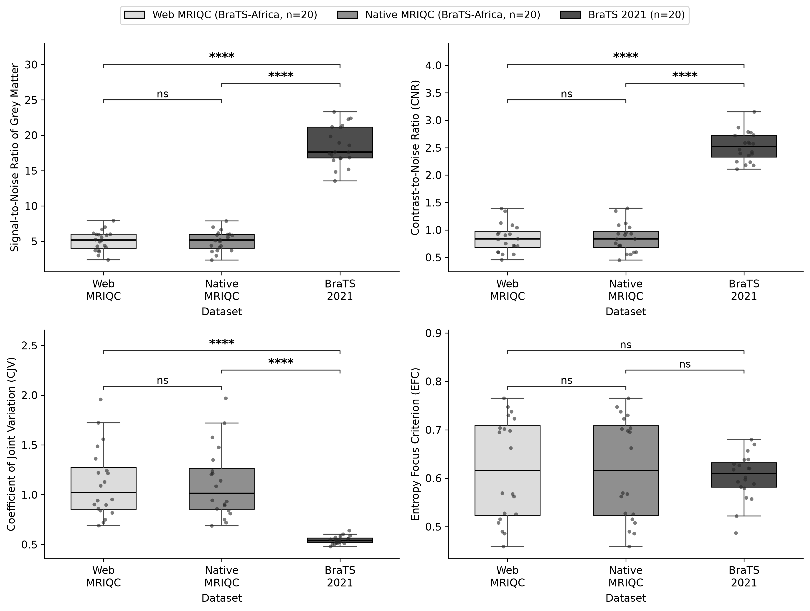

# WebMRIQC

**Automated MRI quality control in the browser — no install, no command line.**

WebMRIQC is a web platform that wraps [MRIQC](https://mriqc.readthedocs.io) (the
gold-standard image-quality tool from [nipreps](https://www.nipreps.org)) behind a
simple upload-and-go interface. Researchers and clinicians upload raw DICOM or a BIDS
dataset, and the platform automatically converts, runs MRIQC, extracts the
image-quality metrics (IQMs), and shows how each scan compares to open reference data —
all from a browser, on a shared high-performance server.

It is built for **resource-constrained settings** (notably across Africa), where
installing Docker, Python, FSL/ANTs and the full MRIQC stack on every workstation is a
real barrier. One powerful server does the compute; everyone else just needs a browser.

> **Live platform:** https://webmriqc.mailab.io

---

## Table of contents

- [Features](#features)
- [How it works](#how-it-works)
- [The DICOM → BIDS pipeline](#the-dicom--bids-pipeline)
- [Architecture](#architecture)
- [Validation](#validation)
- [Quick start (Docker)](#quick-start-docker)
- [Local development](#local-development)
- [Configuration](#configuration)
- [API overview](#api-overview)
- [Project structure](#project-structure)
- [Deployment](#deployment)
- [Credits & license](#credits--license)

---

## Features

| | |
|---|---|
|  **DICOM → BIDS, automatically** | Upload a zipped DICOM folder; the server runs `dcm2niix` + `dcm2bids`, classifies each series, and lays out a valid BIDS dataset — no manual config file needed. |
|  **One-click MRIQC** | Runs MRIQC on the dataset and returns the per-image IQMs plus the full HTML report, packaged as a downloadable ZIP. |
|  **Benchmark comparison** | Every metric is ranked against a bundled open reference population (33-subject OpenNeuro T1w set) so you instantly see whether a scan is typical or an outlier. |
|  **Accounts & history** | Register/log in to keep a permanent history of your runs, their metrics, and their benchmark percentiles. |
|  **Open metrics pool** | Opt in to share a run's metrics to a public benchmark pool, growing a community reference dataset. |
|  **Live impact tally** | Homepage counters for scans QC'd, countries reached, and users — country is derived privately from request geolocation. |
|  **Built-in AI assistant** | A support chatbot (Google Gemini) answers MRIQC / BIDS / usage questions in context. |
|  **Fair-share job queue** | A disk-backed queue runs multiple jobs concurrently and shares capacity fairly across users on the shared server. |

---

## How it works

```
        Browser (React SPA)
            │  upload DICOM .zip  /  BIDS .zip
            ▼
     FastAPI  ── POST /convert-dicom ──► dcm2niix + dcm2bids  ──► BIDS dataset
        │      ── POST /run-mriqc ──────► MRIQC (nipreps)      ──► IQMs + HTML report
        │
        ├─ disk job store  /tmp/webmriqc_jobs/<job_id>/  (running · done · error · result.zip)
        ├─ fair-share queue (N concurrent, rest queued)
        └─ SQLite accounts + submission history  (/data/webmriqc.db)
            │
            ▼
     Results page: metrics table, benchmark percentiles, downloadable ZIP
```

The **frontend and backend ship as a single Docker image**: the React app is built to
static files at image-build time and served by the same FastAPI process that exposes the
JSON API, so there is only one thing to deploy.

---

## The DICOM → BIDS pipeline

MRIQC requires a **BIDS-organized** dataset, but most sites have loose DICOM exports with
inconsistent, scanner-specific series names. WebMRIQC bridges that gap automatically. The
conversion (in `server.py`, `build_bids_from_dicom()`) is a standard five-step `dcm2bids`
flow, with a **generated-on-the-fly config** so it works on *any* subject without a
hand-written mapping:

1. **`dcm2bids_scaffold`** — create the empty BIDS skeleton.
2. **`dcm2bids_helper`** — run `dcm2niix` on every series to produce NIfTI + JSON sidecars
   for inspection.
3. **`build_dcm2bids_config()`** — read those sidecars and *generate* a `dcm2bids` config
   whose criteria match this subject's real series, labelling each series by its
   **acquisition parameters** (see below).
4. **`dcm2bids`** — pick the matched files and place them in the BIDS tree.
5. **Validate** — a non-blocking structural check (and the official `bids-validator` if
   installed) confirms a `dataset_description.json` and at least one image+sidecar pair.

### How series are selected and classified

Each series is labelled by **how it was acquired**, not by how the operator named it.

- **Parameter-based classifier (default).** `bids_classifier/` reads the original DICOM
  headers with `pydicom` and scores each series on its acquisition parameters —
  echo / repetition / inversion times, 2D vs 3D, gradient- vs spin-echo, EPI readout, flip
  angle, b-values and directions, volume count, and the Siemens / Philips / GE private
  headers — against a weighted rulebook, then reads the session as a whole (an SBRef before
  its run, a reversed-phase fieldmap, the two inversions of an MP2RAGE). This places vendor
  sequences whose names give nothing away — e.g. a Philips `sT1W_3D_TFE_IR` as `anat/T1w`,
  or a BOLD run exported as `FE_EPI` as `func/bold`, which a name rule would miss. The
  scoring engine, feature extractor and rulebook are vendored verbatim from
  **[BIDS-Manager](https://github.com/ANCPLabOldenburg/BIDS-Manager)** (MIT); WebMRIQC adds
  only the thin DICOM-reading adapter. Set **`BIDS_PARAM_CLASSIFY=0`** to turn it off.
- **Name-based fallback (`classify_series()`).** Wherever the parameters are inconclusive,
  a metadata-first + name classifier decides instead — so the parameters lead and the names
  are the safety net (it is never *worse* than name-only). It is underscore-safe
  (`t2_tse_cor` is normalized before matching) and knows vendor aliases (MPRAGE, BRAVO,
  SPACE, CUBE, FSPGR, TIRM…).
- **Junk is dropped.** Localizers, scouts, screenshots, phoenix reports, and derived
  parametric maps (ADC, FA, CBF, TTP…) are recognized and omitted.
- **One best image per anatomical modality.** When several same-modality series exist
  (e.g. a NORM and non-NORM copy of one MPRAGE, or repeats), `_series_rank()` keeps the
  single best one — preferring `ORIGINAL`/`PRIMARY` over `DERIVED`/`SECONDARY`, 3D and
  prescan-normalized acquisitions, then the largest image. Functional, diffusion, field-map
  and multi-inversion / phase acquisitions are legitimately distinct, so those are all kept
  (numbered `run-1`, `run-2`, … or separated by `inv-` / `part-`).
- **Nothing is silently lost.** A real image that matches no standard modality (e.g. a
  de-identified, NIfTI-derived export) is rescued into `anat/<fallback>` rather than
  producing an empty dataset, so MRIQC always receives usable data.

Finally, `create_bids_top_level_files()` writes clean top-level BIDS files
(`dataset_description.json`, a non-empty `README`, `CHANGES`, `participants.tsv/.json`) —
`dcm2bids_scaffold` ships a **0-byte README** that fails BIDS validation, so it is
overwritten.

---

## Architecture

- **Frontend:** React 19 + Vite 6, React Router 7, a `three.js` rotating brain on the
  homepage, `jszip` for client-side packaging.
- **Backend:** FastAPI on `uvicorn` (multiple workers). Long jobs run in background
  threads; **job state lives on disk** (`/tmp/webmriqc_jobs/<job_id>/`) so every worker
  sees the same status.
- **Compute image:** built `FROM nipreps/mriqc:24.0.2` (MRIQC + ANTs + neuro deps
  preinstalled), with `dcm2niix`, `dcm2bids`, FastAPI and `uvicorn` layered on top.
- **Accounts:** SQLite (`/data/webmriqc.db` on a named Docker volume), pbkdf2 password
  hashing, hand-rolled HS256 JWTs.
- **Queue:** a fair-share scheduler with `MAX_CONCURRENT_JOBS` running and the rest
  queued, plus a background sweeper that cleans up finished/stale job directories.

---

## Validation

Because WebMRIQC runs the **unmodified** MRIQC engine, its metrics should match a native
MRIQC installation exactly. We verified this on matched scans from the **BraTS-Africa** and
**BraTS 2021** datasets, as reported in our MICCAI 2026 (MIRASOL workshop) paper.

### Measurement equivalence — web vs native MRIQC

Across all 13 image-quality metrics, WebMRIQC reproduces native MRIQC with **excellent
absolute agreement** — intraclass correlation **ICC(2,1) ≥ 0.999** for every metric, with
five (EFC and the four FWHM measures) numerically identical. Bias (Web − Native) is
negligible and the 95% limits of agreement are tight.

| Metric | Mean ± SD (Native) | Mean ± SD (Web) | ICC(2,1) | Bias (Web − Native) [p] | 95% LoA |
|---|---|---|---|---|---|
| CJV | 1.126 ± 0.348 | 1.127 ± 0.346 | 0.9997 | 0.0015 (p = 0.417) | [−0.0149, 0.0179] |
| CNR | 0.847 ± 0.253 | 0.846 ± 0.252 | 0.9999 | −0.0016 (p = 0.080) | [−0.0092, 0.0061] |
| EFC | 0.626 ± 0.108 | 0.626 ± 0.108 | 1.0000 | 0.0000 (p = 1.000) | [0.0000, 0.0000] |
| FBER | 10338.63 ± 12688.49 | 10338.57 ± 12688.47 | 1.0000 | −0.0582 (p = 0.345) | [−0.5983, 0.4819] |
| FWHM-avg (mm) | 3.431 ± 0.668 | 3.431 ± 0.668 | 1.0000 | 0.0000 (p = 0.859) | [0.0000, 0.0000] |
| FWHM-x (mm) | 3.012 ± 0.610 | 3.012 ± 0.610 | 1.0000 | 0.0000 (p = 0.187) | [0.0000, 0.0000] |
| FWHM-y (mm) | 3.921 ± 0.846 | 3.921 ± 0.846 | 1.0000 | 0.0000 (p = 0.127) | [0.0000, 0.0000] |
| FWHM-z (mm) | 3.360 ± 0.573 | 3.360 ± 0.573 | 1.0000 | 0.0000 (p = 0.166) | [0.0000, 0.0000] |
| SNR-CSF | 1.728 ± 0.201 | 1.728 ± 0.202 | 0.9999 | 0.0003 (p = 0.709) | [−0.0065, 0.0071] |
| SNR-GM | 5.181 ± 1.461 | 5.186 ± 1.463 | 0.9999 | 0.0053 (p = 0.319) | [−0.0412, 0.0518] |
| SNR-Total | 6.276 ± 1.332 | 6.278 ± 1.336 | 0.9999 | 0.0025 (p = 0.475) | [−0.0281, 0.0330] |
| SNR-WM | 11.918 ± 2.896 | 11.920 ± 2.904 | 1.0000 | 0.0018 (p = 0.748) | [−0.0489, 0.0525] |
| WM2MAX | 0.562 ± 0.211 | 0.562 ± 0.211 | 1.0000 | 0.0000 (p = 0.650) | [−0.0005, 0.0004] |

<sub>Matched BraTS-Africa cohort (n = 20). ICC(2,1) = two-way random-effects, absolute-agreement
intraclass correlation (single measures); Bias = mean difference (Web − Native) with its paired
*t*-test *p*-value; LoA = 95% limits of agreement (bias ± 1.96 SD). Rows with p = 1.000 and
LoA = [0, 0] are computed identically by both platforms.</sub>

### Benchmarking against reference data

WebMRIQC also places each scan against reference distributions. Comparing the matched
BraTS-Africa measurements (web and native) against the BraTS 2021 benchmark shows the
expected large between-dataset differences for the signal/contrast metrics — SNR-GM, CNR
and CJV (Welch's unpaired *t*-test, p < 0.0001) — and no difference for the entropy focus
criterion (EFC), while web and native measurements remain statistically indistinguishable
throughout.



<sub>Four core IQMs for Web-MRIQC and Native-MRIQC on BraTS-Africa (n = 20 each) versus the
BraTS 2021 benchmark (n = 20). Boxes show median and IQR; whiskers extend to 1.5×IQR; points are
individual subjects. Significance: Welch's unpaired *t*-test (**** p < 0.0001; ns, not significant).</sub>

---

## Quick start (Docker)

Everything (frontend + API + MRIQC + dcm2bids) is in one image.

```bash
git clone https://github.com/NkwamPhilip/mriqc-web.git
cd mriqc-web

# create a .env (see Configuration) — at minimum set AUTH_SECRET:
echo "AUTH_SECRET=$(openssl rand -hex 32)" >> .env

docker compose up -d --build
```

Then open **http://<server-ip>:8050** (the default host port; change with `PORT`).

> **Note:** the image pulls MRIQC's dependencies and is large. First build takes a while;
> the healthcheck has a 90s grace period on first run.

## Local development

Frontend hot-reload against a running backend:

```bash
npm install
npm run dev          # Vite dev server on http://localhost:5173
```

Backend (needs `dcm2bids`, `dcm2niix`, and `mriqc` on PATH — easiest inside the Docker
image, or a conda/venv with them installed):

```bash
pip install fastapi "uvicorn[standard]" python-multipart dcm2bids httpx
uvicorn server:app --reload --port 8000
```

---

## Configuration

All configuration is via environment variables (put them in a gitignored `.env`):

| Variable | Default | Purpose |
|---|---|---|
| `PORT` | `8050` | Host port the site is served on. |
| `WORKERS` | `16` | Uvicorn worker processes (HTTP concurrency). |
| `MAX_CONCURRENT_JOBS` | `10` | MRIQC/conversion jobs running at once. |
| `MAX_QUEUE_SIZE` | `100` | Max jobs waiting in the queue. |
| `BIDS_PARAM_CLASSIFY` | `1` | Acquisition-parameter BIDS classifier (default on). Set `0` to fall back to the name-based classifier only. |
| `BIDS_BACKEND` | `dcm2bids` | DICOM→BIDS backend: `dcm2bids` (default, with the parameter classifier) or `bidsmgr` (external BIDS-Manager CLI — needs it installed, located via `BIDSMGR_DIR` or `PATH`). |
| `AUTH_SECRET` | *(required)* | HS256 signing secret. Set it so logins survive restarts — `openssl rand -hex 32`. |
| `DATA_DIR` | `/data` | Where the accounts SQLite DB lives (persisted via named volume). |
| `GEMINI_API_KEY` | – | Enables the AI support chatbot ([get a free key](https://aistudio.google.com/app/apikey)). |
| `GEMINI_MODEL` | `gemini-2.0-flash` | Model used by the chatbot. |
| `GOOGLE_CLIENT_ID` | – | Optional "Sign in with Google" OAuth client ID (button hidden if unset). |
| `SUPPORT_EMAIL`, `SMTP_*` | – | Route support tickets to a lab inbox (Gmail App Password required). |
| `IMPACT_BASE_SCANS/COUNTRIES/USERS` | `0` | Seed the homepage impact counters with prior/offline usage. |

---

## API overview

| Method & path | Auth | Description |
|---|---|---|
| `GET /health` | – | Liveness + tool availability (`dcm2bids`, `dcm2niix`, `mriqc`). |
| `POST /convert-dicom` | ✅ | Upload zipped DICOM → returns a BIDS dataset job. |
| `POST /run-mriqc` | ✅ | Run MRIQC on an uploaded BIDS/DICOM dataset → IQMs + report. |
| `GET /job/{job_id}` | – | Job status (`queued` / `running` / `done` / `error`, queue position). |
| `GET /job/{job_id}/download` | – | Download the result ZIP. |
| `POST /auth/register`, `/auth/login` | – | Create account / sign in (JWT). |
| `GET /auth/submissions` | ✅ | The signed-in user's run history + metrics. |
| `PATCH /auth/submissions/{id}/visibility` | ✅ | Toggle a run's metrics public/private. |
| `GET /stats/impact` | – | Live scans / countries / users counters. |
| `GET /stats/open-metrics` | – | Aggregated public benchmark metrics. |

See `server.py` for the complete, authoritative list.

---

## Project structure

```
mriqc-web/
├── server.py              # FastAPI app: DICOM→BIDS, MRIQC runner, queue, auth, stats, chat
├── Dockerfile             # 2-stage: build React → layer onto nipreps/mriqc:24.0.2
├── docker-compose.yml     # single-container deployment + named DB volume
├── src/                   # React frontend
│   ├── pages/             # Home, Analyze, Compare, MySubmissions, Login/Register, …
│   ├── components/        # BrainModel (three.js), Navbar, MriqcReport, Support, …
│   ├── context/           # AuthContext
│   ├── lib/               # api.js (fetch wrappers), reference.js (benchmark ranking)
│   └── data/              # reference_t1w.tsv (open reference population)
├── nginx.conf             # optional reverse proxy for HTTPS
└── DEPLOY.md              # deployment guide
```

---

## Deployment

The live instance runs the single Docker container on a high-memory compute server and is
exposed publicly through a **Cloudflare Tunnel** (no open inbound ports; TLS terminated at
Cloudflare). The compose file is tuned for a large shared server — raise/lower `WORKERS`,
`MAX_CONCURRENT_JOBS`, `shm_size` and `mem_reservation` to match your hardware. For a
self-hosted HTTPS setup without Cloudflare, uncomment the `nginx` service in
`docker-compose.yml` and provide certificates (see `DEPLOY.md`).

---

## Credits & license

WebMRIQC is developed by the **MAILAB** team — Philip Nkwam, Udunna Anazodo,
Maruf Adewole and Sekinat Aderibigbe.

It stands entirely on open-source neuroimaging tools:

- **[MRIQC](https://mriqc.readthedocs.io)** and the **[nipreps](https://www.nipreps.org)**
  ecosystem (Apache-2.0) — the quality-control engine.
- **[dcm2bids](https://unfmontreal.github.io/Dcm2Bids/)** and
  **[dcm2niix](https://github.com/rordenlab/dcm2niix)** — DICOM → BIDS conversion.
- **[BIDS-Manager](https://github.com/ANCPLabOldenburg/BIDS-Manager)** (ANCP Lab Oldenburg,
  MIT) — its acquisition-parameter classifier (scoring engine, feature extractor and
  rulebook) is vendored in `bids_classifier/`; see `bids_classifier/LICENSE_bids-manager.txt`.
- **[BIDS](https://bids.neuroimaging.io/)** — the dataset standard everything targets.

Please cite MRIQC and BIDS in any work that uses this platform. Add a `LICENSE` file to
declare the terms for the WebMRIQC application code itself.
